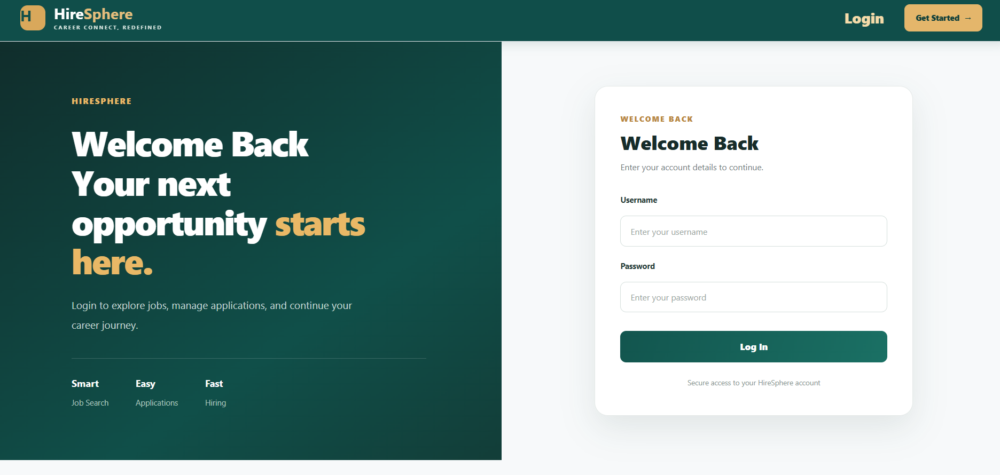

# HireSphere – Hiring Management System

<p align="center">
  <b>A Full-Stack Recruitment Management Platform</b>
  <br/>
  Built using React.js, Java, Spring Boot, and MySQL.
</p>

## 📌 About the Project

HireSphere is a full-stack hiring management application designed to simplify the recruitment process by connecting Job Seekers, Employers, and Administrators through a centralized platform.

## ✨ Key Features

- Role-Based Authentication for Job Seekers, Employers, and Administrators.
- Secure User Registration and Login using JWT.
- Job Posting and Management for Employers.
- Job Browsing and Application for Job Seekers.
- RESTful APIs for backend communication.
- MySQL Database Integration.
- Application Management.

## 🛠️ Technology Stack

| Category | Technologies |
|---|---|
| Frontend | React.js |
| Backend | Java 17, Spring Boot |
| Database | MySQL |
| Authentication | JWT |
| API | REST APIs |
| Tools | Git, GitHub, Maven |

## 📂 Project Structure

```text
HireSphere/
├── backend/
│   └── Spring Boot Application
├── frontend/
│   └── React Application
├── screenshots/
│   └── Project Screenshots
└── README.md
```

## Screenshots

### Home Page


### Registration Page


### Login Page


### Job Seeker Dashboard


### Employer Dashboard


### Admin Dashboard


## 🚀 Getting Started

### Prerequisites

- Java 17
- Node.js and npm
- MySQL
- Maven
- Git

### 1. Clone Repository

```bash
git clone https://github.com/727724eucb047-design/Hiresphere.git
```

### 2. Backend Setup

Configure your MySQL database in the backend `application.properties` file.

```bash
cd backend
mvn spring-boot:run
```

### 3. Frontend Setup

Open another terminal:

```bash
cd frontend
npm install
npm start
```

*Note: Update the folder names and commands if your actual project configuration differs.*

## 🔗 API Modules

- Authentication
- Job Posting
- Job Management
- Job Applications

## 👩‍💻 My Contributions

- Full-stack application development.
- Backend development using Java and Spring Boot.
- REST API development and integration.
- Role-based authentication.
- Database integration using MySQL.

## 🔮 Future Enhancements

- AI-powered Job Recommendations.
- Resume Parsing and Skill Matching.
- Advanced Job Search and Filtering.
- Application Status Notifications.

## 👤 Author

**Sathana R**

B.Tech – Computer Science and Business Systems

[GitHub Profile](https://github.com/727724eucb047-design)
